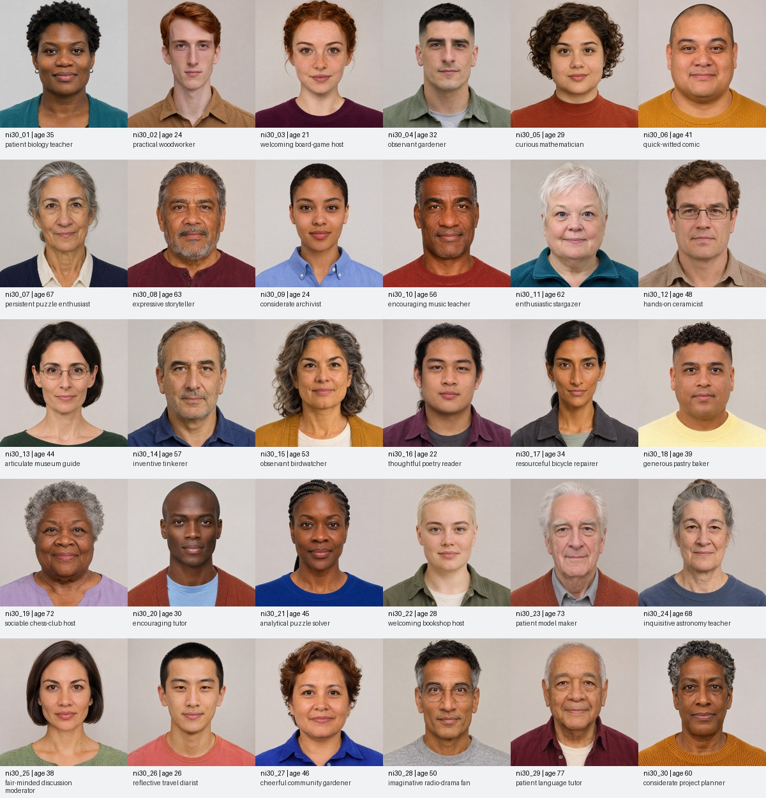

# Thirty new characters: full model versus trained student

**Complete: the frozen student fails all 60 new-face clips in both precisions.** The full-model fp16 control
passes all 60. These 30 fictional identities were created after the student weights were frozen, using the
built-in image generator without reference images. They were never used for training or checkpoint selection.
The smaller student does not meet the requirement to preserve quality across new characters.

| Arm against full fp32 reference A | r5 passes | Failed / incomplete | Identities with both clips passing |
|---|---:|---:|---:|
| N: full model fp16 | 60/60 | 0 / 0 | 30/30 |
| S: student fp32 | 0/60 | 60 / 0 | 0/30 |
| S16: student fp16 | 0/60 | 60 / 0 | 0/30 |

[Open the searchable gallery](gallery.html) for **all 60 A | S comparison videos**, two per character.
The [complete report](summary.md), [machine-readable report](summary.json) and
[independent numerical and limited still review](visual_review.md) retain the findings. The full model is on
the left and the student on the right, with labels and mouth zooms. There were no omitted clips: all four
arms have 250 finite landmark frames on every clip.

Student fp32 lip correlation is **0.78306–0.96502** (required ≥0.97), and mean aperture error is
**0.7846–4.5852 px** (required ≤0.5 px). Every clip fails both checks. Sharpness also fails on 52/60 clips,
and lag on 13/60. Student fp16 is nearly identical. The quality gap is already present before Core ML export;
these results do not isolate its training or architecture cause. The earlier two trials' 0/12 student
quality results remain rejected.

[Character profiles and complete prompts](characters.json), [generation provenance](generation_provenance.json)
and [input face checks](portrait_checks.json) record the accepted images. All 30 have distinct source hashes
and exactly one detectable 468-landmark face after the documented normalization. This checks the inputs;
it does not establish lipsync quality. Personality descriptions are authored fictional concepts.

Each character received the same two held-out speech clips, producing 60 full-model/student comparisons,
250 frames at 25 fps per arm. The [fixed evaluation plan](plan.md) defines the models, hashes, thresholds,
controls and required coverage. The frozen `characters.json` retains its original pre-evaluation status;
the reports above give the current result.
This uses static source portraits: lips move during inference, while head/body motion remains frozen.
It tests a broader set of new faces, and cannot establish support for every possible character or pose.
No historical phone-chain D baseline exists for these identities. S16 is CUDA/PyTorch fp16, not a measurement
of quantized Core ML/ANE quality. Encoded 25-fps videos are not a new phone throughput measurement.

Small JPEG previews are committed in [portraits/](portraits/). Native 1254-square source PNGs remain locally
under `generated/new_identities_2026-11-04/portraits/`, with hashes here and full source copies in the verified
local result archive. Previews are resized copies; evaluation preparation used the native sources.

The review ran at code `604ffac76177096a3ab236b1a66f35026553e523` on one RTX 3090. Its preparation and
scoring code is unchanged from `6cdc8ca`; the later commit reduced only packaging's timing allowance before
inference, preserving the original four-hour expiry and 20-minute pull/cleanup reserve. See
[run provenance](run/provenance.json), [the recovery record](run/pre_inference_recovery.json) and
[tooling review](build_review.md). Weights, audio, identities and thresholds stayed frozen; no retraining occurred.

The original 291,880,960-byte archive and its SHA256
`6b794b6da0223b09580fefd18d80b82f4bf55dad368de7869166dfe84eae10cc` are retained locally under
`.runtime/new_identity_audit/`. That archive contains full-resolution CRF26 presentation A | S copies,
all 60 original renderer S16 MP4 files, source PNGs, caches, logs and original metrics. Public comparisons
are 768px-wide H.264 CRF30 with AAC 32 kbps mono presentation audio at its original sample rate. Their
250 frames, 25 fps and ten-second video timing are verified. Raw-frame metrics and original test audio
are unchanged. Model weights and native PNGs are excluded from git.

[Frame-by-frame lip curves](run/aperture_series_manifest.json) are retained for all 60 clips and four arms.
They were exported read-only from existing landmarks after rendering; all 180 aperture aggregates exactly
matched the saved scores. No inference, rescoring or original archive modification occurred.

The user explicitly approved one additional validation-only RTX 3090, at most $0.30/hour for four hours,
with expiry installed before its single create. Instance **59107834 was destroyed**; provider absence and
its **inactive** expiry timer were independently verified at **2026-11-04 16:42:34 UTC**. Both earlier test
rentals are also destroyed. Temporary transfer objects/versions are deleted and the known multipart upload
is inactive. No further rental is authorized.

The new rental estimate is **$0.94880**, earlier rentals **$1.72268**, and the conservative AWS transport
allowance **$0.29**: **$2.96148 combined**, below $10. This is estimated, not invoice-confirmed; tax is excluded.
The [cost and cleanup receipt](rental_receipt.json) and [readable calculation](rental_receipt.md) record the proofs.
No phone, Lingua or production model changes were made for this validation.
