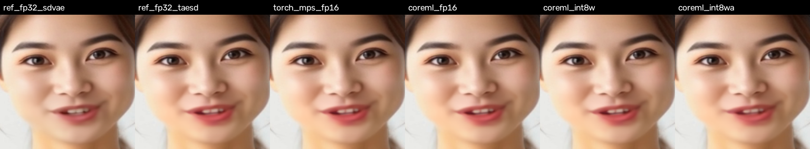
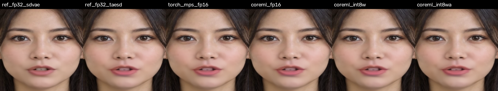
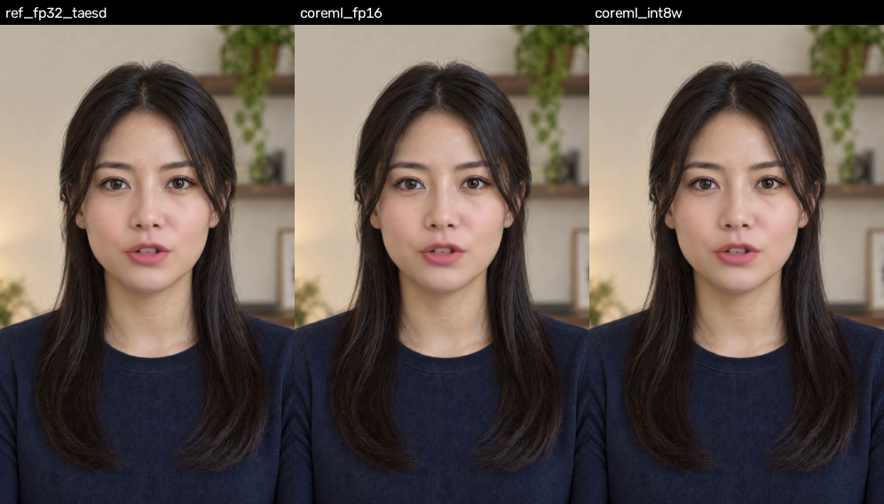
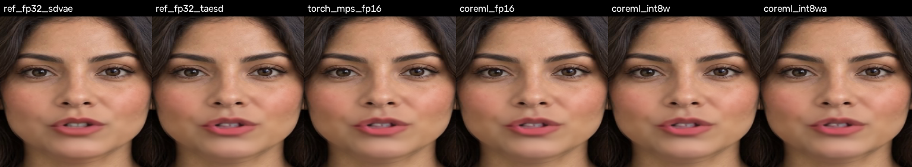
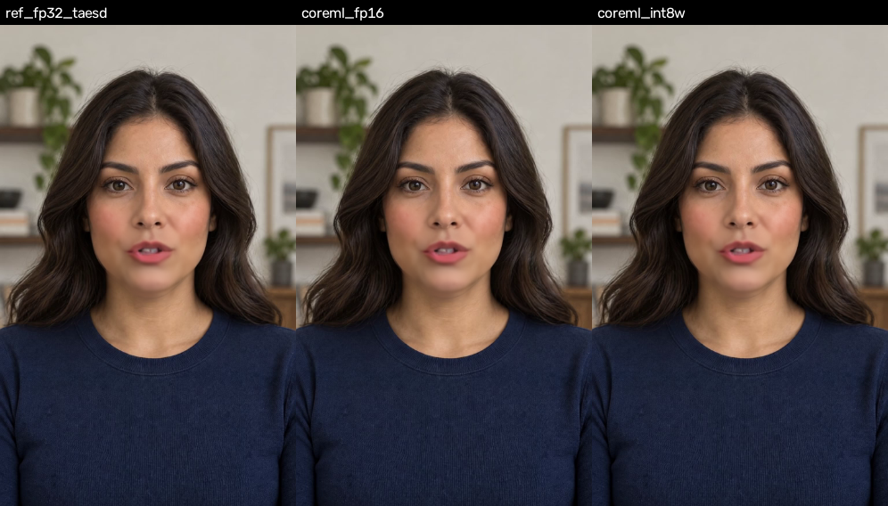

# MuseTalk on an Apple Neural Engine: baseline, Core ML conversion, evidence (2026-10-30)

**Question.** Can the MuseTalk v1.5 live path (one UNet step + decoder per frame) run on an iPhone in real
time for one user, at the quality of the GPU servers? The servers reach ~400 fps aggregate on an RTX 4070
SUPER / 3090 with TensorRT INT8 engines, but that is 15–20 streams at 20 fps each, ~2.5 ms of GPU per frame.

**Verdict.** On this Mac's M5 Pro Neural Engine, the same ANE generation as the iPhone 17 Pro's, the whole
per-frame path runs at **28.9 ms/frame in fp16 and 25.3 ms/frame with int8 weights**, against a 50 ms budget at
the server's 20 fps (40 ms at 25 fps). A 10 s turn renders in 6.3–7.2 s of inference, chunk by chunk. Both
builds pass the server's numeric gate (latent max-abs ≤ 0.5 against fp32) and are visually indistinguishable
from the PyTorch reference on the two 9:16 production characters (Japanese, Latina) and a smoke avatar
(face-crop error 0.16–0.30/255, 46–54 dB PSNR over 250 frames each; §5). Naive int8 activations are
faster (20.6 ms) but fail the gate. **No iPhone was measured**: the only phone available is an iPhone 12 Pro,
whose A14 Neural Engine and 34 GB/s memory bus put it well below real time. Expected on real devices, unmeasured:
iPhone 17 Pro ~25–30 ms/frame, iPhone 15/16 Pro ~30–40 ms (real time at 20 fps, thin at 25), iPhone 12 Pro
~50–80 ms (not real time). "Same exact quality and speed" as the server is not on the table: ~10× slower per
frame (one stream's worth) and a different, gated numeric path.

Branch `claude/ios-unet-bench`, worktree `~/code/musetalk-ios-bench`. Nothing here touches the server path.

## 1. Setup

| Item | Value |
|---|---|
| Host | Apple M5 Pro, 24 GB, macOS 27.0.1, Xcode 27 |
| Baseline venv | `.venv-ios`: Python 3.12.12, torch 2.15.0 (MPS), diffusers 0.42.1 |
| Export venv | `.venv-ct`: torch 2.7.0 (coremltools' newest tested torch), coremltools 9.0, diffusers 0.42.1 |
| UNet | HF `TMElyralab/MuseTalk` `musetalkV15/unet.pth` (fp32, 3.4 GB; 849.9M params), `musetalk.json` |
| Decoders | TAESD (`madebyollin/taesd`, the server's decoder); SD-VAE `stabilityai/sd-vae-ft-mse` for the stock reference |
| Audio features | Whisper-tiny encoder, repo `AudioProcessor` windows (50×384 per frame at the 50 Hz / 25 fps timeline) |
| Avatar | `codex_smoke` from S3 `avatars/v15` (600 frames, 512×512, cached latents, masks, coords) |
| Audio | `data/audio/ai-assistant.mpga` (17.8 s; the first 10 s = 250 frames at 25 fps are used) |

Scripts (all under `scripts/ios/`): `bench_torch_baseline.py`, `export_coreml.py`, `bench_coreml.py`,
`render_evidence.py`. Results JSON under `docs/ios_unet_bench/`. Core ML models and videos are under
`models/ios_bench/` (not in git).

## 2. What was converted

The Core ML UNet model is the whole per-frame UNet step the server runs: inputs `sample` [B,8,32,32] (masked
face latent + reference latent) and `audio` [B,50,384] (raw Whisper window); the sinusoidal positional encoding
and the fixed timestep 0 are inside the graph; output `pred_latents` [B,4,32,32]. Attention uses diffusers'
explicit `AttnProcessor` (matmul + softmax), target iOS 17, fp16 compute.

- `torch.jit.trace` fails in coremltools 9 on 592 `aten::Int` shape casts (`height*width` reshapes and
  `batch//heads` in attention) that it cannot fold; `torch.export` + `run_decompositions({})` specializes them.
- Variants: **fp16** (1,622 MB), **int8w** (int8 per-channel linear weights, fp16 activations, 812 MB),
  **int8wa** (int8 weights and per-tensor activations, calibrated on 16 real frames, 813 MB). One model per batch
  size 1, 4, 8 (int8wa at 8 was not built; the variant fails quality at 1 and 4).
- TAESD decoder [B,4,32,32] → [B,3,256,256] in [0,1], fp16, 2.4 MB, with the server's `(x/2+0.5).clamp`.

## 3. PyTorch baseline on this Mac (`baseline_torch_m5pro.json`)

Real avatar latents and real Whisper windows; median of 30 iterations after 5 warm-ups; step = PE + UNet + TAESD.

| Device | dtype | batch | UNet ms/frame | TAESD ms/frame | step ms/frame | single-stream fps |
|---|---|---|---|---|---|---|
| MPS (GPU) | fp16 | 1 | 47.6 | 3.4 | 51.0 | 19.6 |
| MPS | fp16 | 4 | 21.9 | 2.2 | 24.1 | 41.5 |
| MPS | fp16 | 8 | 18.8 | 2.1 | 20.9 | 47.9 |
| MPS | fp16 | 16 | 17.2 | 2.0 | 19.2 | 52.2 |
| MPS | fp32 | 4 | 33.1 | 4.7 | 37.8 | 26.5 |
| CPU | fp32 | 1 | 203.6 | 75.0 | 277.9 | 3.6 |
| CPU | fp32 | 4 | 141.4 | 40.7 | 182.6 | 5.5 |

Whisper-tiny encoder: 3.5 ms per 30 s audio segment on MPS fp16 (per turn, not per frame). Plain PyTorch on
the Mac GPU is already real time at batch ≥ 4; it is not the phone path, but it is the "stock MuseTalk on a Mac"
number.

## 4. Core ML on the Neural Engine (`coreml_m5pro.json`)

`compute_units=CPU_AND_NE`, 100 timed predictions after 20 warm-ups; `cpu` = CPU_ONLY, `all` = CPU+GPU+ANE
(20 runs each). Placement is Core ML's compute plan (ops per device).

| Model | MB | ANE ms/frame | CPU-only | all | placement | latent max-abs vs fp32 | face err /255 (16 fr) |
|---|---|---|---|---|---|---|---|
| UNet fp16, batch 1 | 1,622 | **27.1** | 73.4 | 18.8 | 1,778 ops ANE | 0.37 | 0.43 |
| UNet int8w, batch 1 | 812 | **23.5** | 73.7 | 22.3 | 1,778 ops ANE | 0.41 | 0.48 |
| UNet int8wa, batch 1 | 813 | 19.0 | 88.0 | 18.3 | 3,074 ops ANE | **1.68 (fails)** | 1.63, worst pixel 83 |
| UNet fp16, batch 4 | 1,622 | 314 | 61.6 | 9.3 | **1,778 ops CPU** | 0.23 | 0.22 |
| UNet int8w, batch 4 | 812 | 314 | 61.6 | 10.2 | **1,778 ops CPU** | 0.20 | 0.25 |
| UNet fp16, batch 8 (short run) | 1,622 | 320 | 60.7 | 8.6 | **1,778 ops CPU** | – | – |
| UNet int8w, batch 8 (short run) | 812 | 315 | 60.3 | 9.7 | **1,778 ops CPU** | – | – |
| TAESD fp16, batch 1 / 4 / 8 | 2.4 | 1.52 / 1.43 / 1.40 | 12–14 | 1.3–1.9 | 83 ops ANE | – | 0.08 |

Reading it:

- **Batch 1 is the Neural Engine path.** Every UNet op lands on the ANE; the model loads in 5–7 s (first-load
  compile is cached by Core ML afterwards).
- **Batch 4 is rejected by the ANE compiler**: every op falls to the CPU, where the CPU_AND_NE path is 5× slower
  than CPU_ONLY (a single-threaded fallback), while `all` runs it on the Mac GPU at 9–10 ms/frame. Batching
  therefore needs a graph change (§7), not more hardware.
- **int8 weights buy 13% on this Mac** (23.5 vs 27.1 ms) because the M5 Pro's bus (~150 GB/s) is not the limit
  here: the fp16 model streams 1.62 GB in 27 ms (60 GB/s), the int8w model 0.81 GB in 23.5 ms (35 GB/s), so
  int8w is compute-bound on this ANE. On a phone bus (34–77 GB/s) the halved traffic is what keeps fp16-class
  speed possible (§6).
- **int8 activations (naive, per-tensor) fail**: 4× the latent error of fp16, visible as a 138/255 worst pixel
  in the 250-frame render. The same lesson as the server's r5 work: only a layer-selective recipe passed there.
- The `all` setting is faster than ANE-only on this Mac (18.8 ms fp16 batch 1) because Core ML spreads the graph
  over the GPU and ANE; phone GPUs are far weaker, so ANE-only is the number that transfers.

## 5. Quality gate and video evidence (`evidence/evidence_metrics.json`)

Same 10 s turn (250 frames) rendered through six paths with the repo's own audio windows, cached latents and
`get_image_blending`, i.e. `realtime_inference.py`'s loop minus preprocessing. Reference = PyTorch fp32 UNet +
fp32 TAESD (the production decoder). Errors are mean absolute pixel error in 0–255 over the 256×256 face crop.

| Path | render ms/frame | face err vs ref | worst pixel | PSNR (face) | full-frame err |
|---|---|---|---|---|---|
| fp32 + SD-VAE (stock MuseTalk decoder) | 504.7 (CPU) | 1.03 | 40 | 40.2 dB | 0.14 |
| fp32 + TAESD (reference) | – | 0 | 0 | – | 0 |
| MPS fp16 + TAESD (baseline) | 127.9* | 0.01 | 2 | 68.2 dB | 0.001 |
| **Core ML fp16 (ANE) + Core ML TAESD** | **28.9** | **0.16** | 32 | 53.3 dB | 0.02 |
| **Core ML int8w (ANE) + Core ML TAESD** | **25.3** | **0.17** | 30 | 53.0 dB | 0.02 |
| Core ML int8wa (ANE) + Core ML TAESD | 20.6 | 0.56 | 138 | 42.5 dB | 0.08 |

\* includes first-call kernel compilation; the baseline table above is the timing source for MPS.

The two passing Core ML builds differ from the reference by 6× less than the decoder choice itself (TAESD vs
SD-VAE: 1.03/255), which the server already accepted. Videos (`models/ios_bench/evidence/`): one full-frame mp4
per path with the audio muxed in, `grid_face_crops.mp4` (six face crops side by side), and
`full_frame_ref_vs_coreml.mp4` (reference vs fp16 vs int8w). Stills at 2 / 5 / 8 s and the ×8 difference heatmap
of Core ML fp16 against the reference are in `docs/ios_unet_bench/evidence/`.




What this does and does not validate: the Core ML UNet and decoder reproduce the PyTorch pipeline's output on
a real avatar with real speech, frame for frame, within the gate. It does not validate lip-sync against the
audio beyond "identical to PyTorch" (the PyTorch pipeline is the ground truth here), and it is not a labelled
human review of the kind the server's r5 went through.

### 5.1 Production characters (9:16): Japanese and Latina

The same render on the two prepared talking caches the server docs use for decoder comparisons,
`japanese_realtime_talking_7d94520b7f` and `latina_guided_20260925_talking_84c5bc80b8` (482 frames each, 512×832
portrait), same audio, same 10 s. Metrics are against each character's own fp32 + TAESD reference.

**Japanese** (`evidence/japanese_realtime_talking_7d94520b7f/`):

| Path | render ms/frame | face err vs ref | worst pixel | PSNR (face) | full-frame err |
|---|---|---|---|---|---|
| fp32 + SD-VAE | 521.1 (CPU) | 0.79 | 80 | 42.7 dB | 0.14 |
| MPS fp16 + TAESD | 107.9* | 0.01 | 2 | 67.6 dB | 0.002 |
| **Core ML fp16 (ANE)** | **28.8** | **0.28** | 94 | 46.7 dB | 0.05 |
| **Core ML int8w (ANE)** | **25.2** | **0.30** | 97 | 46.1 dB | 0.05 |
| Core ML int8wa (ANE) | 20.7 | 0.74 | 156 | 39.2 dB | 0.13 |





The ×8 difference heatmap shows the fp16 Core ML error confined to the lip region the UNet repaints, with the
rest of the face at zero; the per-pixel worst case (94/255) is a single lip-edge pixel in one frame, while the
mean stays a third of the decoder's own TAESD-vs-SD-VAE difference (0.79).

**Latina** (`evidence/latina_guided_20260925_talking_84c5bc80b8/`):

| Path | render ms/frame | face err vs ref | worst pixel | PSNR (face) | full-frame err |
|---|---|---|---|---|---|
| fp32 + SD-VAE | 500.2 (CPU) | 0.74 | 68 | 43.1 dB | 0.13 |
| MPS fp16 + TAESD | 108.1* | 0.01 | 2 | 67.9 dB | 0.002 |
| **Core ML fp16 (ANE)** | **28.8** | **0.17** | 28 | 54.1 dB | 0.03 |
| **Core ML int8w (ANE)** | **25.1** | **0.18** | 31 | 54.0 dB | 0.03 |
| Core ML int8wa (ANE) | 20.6 | 0.65 | 109 | 41.9 dB | 0.11 |





Across the three characters the Core ML fp16 and int8w builds stay within 0.16–0.30/255 of the PyTorch
reference on the face crop (46–54 dB), always below the 0.74–1.03/255 that the production decoder itself
differs from the stock SD-VAE by; int8wa is 0.56–0.74/255 with 109–156/255 worst pixels, consistently the
worst. Speed does not depend on the character: 28.8–28.9 ms/frame fp16 and 25.1–25.3 ms/frame int8w on all
three, end to end on the Neural Engine.

## 6. Back-to-back turns (`turns_*_m5pro.json`)

The real-time question in the product's own terms: 12 consecutive 10 s turns at 25 fps (250 frames each),
rendered in chunks of 1 frame through the Core ML UNet and the Core ML TAESD on the Neural Engine, back to
back with no pause (2 minutes of continuous speech).

| Build | first chunk ready | 250 frames rendered in | real-time factor | ms/frame turn 1 → 12 | drift |
|---|---|---|---|---|---|
| int8w, batch 1 | 25 ms (25.1–26.1) | 6.34–6.37 s | **1.57×** every turn | 25.36 → 25.49 | +0.5% |
| fp16, batch 1 | 29 ms (28.7–29.2) | 7.20–7.26 s | **1.38×** every turn | 28.91 → 29.04 | +0.4% |

Every one of the 24 turns finished well inside its own 10 s, with no slowdown over 2 minutes on this Mac. At
the server's 20 fps the same turn is 200 frames, 5.1 s (int8w) / 5.8 s (fp16): 1.96× / 1.72× real time. Phone
thermals are not represented here (§7).

## 7. From this Mac to a phone

Per frame, the UNet reads its whole weight set once (the ANE has no cache that holds 0.8–1.6 GB), so a phone's
memory bus sets a floor under the frame time regardless of compute:

| Device | ANE | memory bus | floor fp16 (1.62 GB/frame) | floor int8w (0.81 GB) |
|---|---|---|---|---|
| iPhone 12 Pro (A14) | 11 TOPS fp16, no int8 | LPDDR4X ~34 GB/s | 48 ms | 24 ms |
| iPhone 15 Pro (A17 Pro) | 35 TOPS, int8 | LPDDR5 ~51 GB/s | 32 ms | 16 ms |
| iPhone 16 Pro (A18 Pro) | 35 TOPS | LPDDR5X ~60 GB/s | 27 ms | 13.5 ms |
| iPhone 17 Pro (A19 Pro) | 16-core, same generation as M5 | LPDDR5X ~77 GB/s | 21 ms | 10.6 ms |
| this Mac (M5 Pro) | 16-core | ~150 GB/s | measured 27.1 ms | measured 23.5 ms |

On the Mac the int8w model is compute-bound at 23.5 ms. On an iPhone 17 Pro the same ANE generation should land
near that, 25–30 ms with phone clocks and thermals, i.e. real time with margin. On the A17 Pro / A18 Pro ANE
(older, and by Apple's Stable Diffusion benchmarks roughly 1.3–1.5× slower per op than the newest generation)
expect 30–40 ms: real time at 20 fps, borderline at 25. The iPhone 12 Pro's ANE (about a third of the compute,
no int8, 34 GB/s) will not reach 20 fps; 50–80 ms/frame is the expectation. All of these are projections from
one Mac measurement and Apple's published ratios; a real device run is still the missing step.

Other phone-only factors: sustained-load throttling (a call is minutes of continuous turns), a ~2 GB memory
footprint on an app that also holds the avatar's frames and pose caches, and battery.

## 8. Where the remaining speed is (ordered by value)

1. **Ship int8 weights, batch 1, on the ANE** — done here, passes the gate, halves memory traffic. This is the
   phone build.
2. **Make batching run on the ANE.** Today batch > 1 is rejected and falls to the CPU. The likely cause is the
   attention layout at batch×heads = 32 (`baddbmm` over [32,1024,1024]); Apple's Stable Diffusion conversion
   solved the same problem with a split-einsum attention (conv-1×1 + chunked einsums) and, on iOS 18+, the fused
   `scaled_dot_product_attention` op. Batch 4 would cut weight traffic per frame 4× (the fp16 floor on an iPhone
   15 Pro drops from 32 to 8 ms) at the cost of 160 ms of extra latency at 25 fps, well under the server's 2 s
   prebuffer. This is the lever for the A17/A18 phones.
3. **Fuse TAESD and the BGR/uint8 post-processing into the UNet model** so a frame is one Core ML call and one
   buffer copy (saves ~1–2 ms and the fp16 round trip).
4. **Mixed-bit palettization of insensitive layers** (Apple's MBP recipe, 4–6 bit, decompressed in flight by the
   ANE) to cut bytes below int8 without the activation error; re-gate per layer like r5.
5. **Layer-selective int8 activations** (the r5 method, keeping the `up` blocks in fp16): worth ~15–20% more
   compute throughput, only if a real device turns out compute-bound after 1–2. Deferred.
6. **Pipeline:** Whisper-tiny via Core ML (WhisperKit-class), blend in Metal/Accelerate, a dedicated inference
   thread with double-buffered inputs so the UNet never waits on the decoder or the blend.

None of these are needed to hit 20 fps on an iPhone 17 Pro-class ANE if the projection holds; 2 is what makes
the 15/16 Pro comfortable.

## 9. What a product build still needs (unchanged from the desk analysis)

A native module in the Lingua app running the Core ML pipeline; the avatar pose caches (3–6 poses × 160–350
MB) downloaded per character; the pose router, idle/live switching and A/V sync logic ported from
`webrtc_tracks.py` / `webrtc_pose_router.py`; TTS stays remote; a labelled video review of the int8w build like
the one r5 went through; and the device measurement that this doc could not do.

## 10. Reproduce

```bash
cd ~/code/musetalk-ios-bench
uv venv --python python3.12 .venv-ct && uv pip install --python .venv-ct/bin/python torch==2.7.0 diffusers transformers accelerate safetensors numpy psutil coremltools==9.0 scipy opencv-python-headless librosa soundfile einops
.venv-ct/bin/hf download TMElyralab/MuseTalk musetalkV15/unet.pth musetalkV15/musetalk.json --local-dir models
.venv-ct/bin/hf download madebyollin/taesd --local-dir models/taesd
.venv-ct/bin/hf download openai/whisper-tiny config.json generation_config.json preprocessor_config.json model.safetensors --local-dir models/whisper
.venv-ct/bin/hf download stabilityai/sd-vae-ft-mse config.json diffusion_pytorch_model.safetensors --local-dir models/sd-vae
aws s3 cp s3://lingua-musetalk-s3-storage/avatars/v15/codex_smoke.tar.gz /tmp/ && tar -xzf /tmp/codex_smoke.tar.gz -C /tmp/
.venv-ct/bin/python scripts/ios/bench_torch_baseline.py --avatar-latents /tmp/codex_smoke/latents.pt --audio data/audio/ai-assistant.mpga
.venv-ct/bin/python scripts/ios/export_coreml.py --batches 1,4,8 --variants fp16,int8w,int8wa
.venv-ct/bin/python scripts/ios/bench_coreml.py --compare --check
.venv-ct/bin/python scripts/ios/bench_coreml.py --turn-model unet_int8w_b1 --turns 12 --turn-seconds 10 --turn-fps 25
.venv-ct/bin/python scripts/ios/render_evidence.py --avatar /tmp/codex_smoke --audio data/audio/ai-assistant.mpga --seconds 10 --fps 25
```

(The baseline above was measured with torch 2.15.0 in `.venv-ios`; the export needs torch ≤ 2.7 for coremltools 9.)
